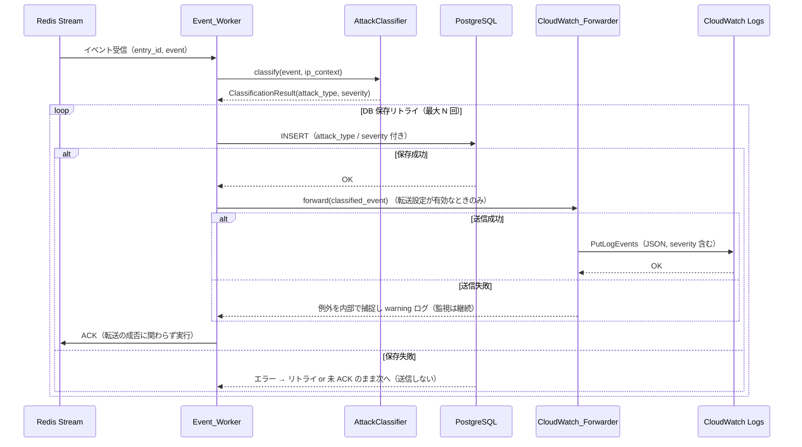
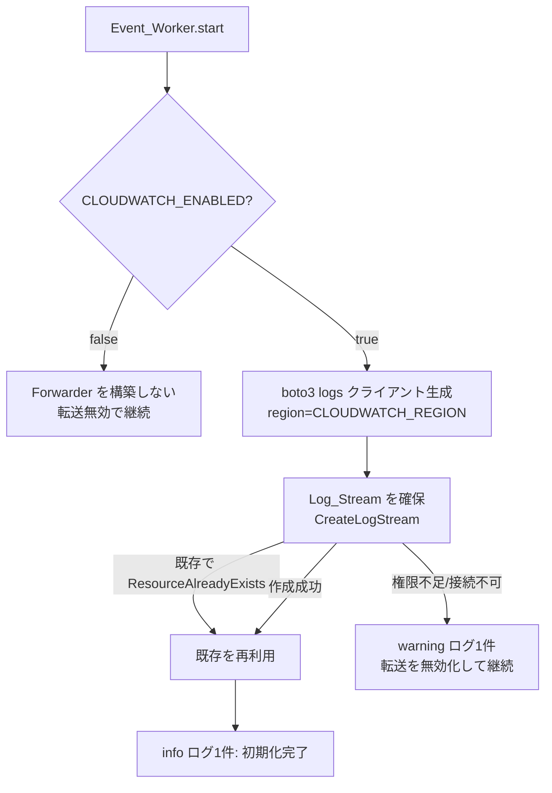

# Design Document

## Overview

本設計は、HoneyWatch の Event_Worker が永続化した分類済み攻撃イベント（`attack_type` / `severity` 付与済み）を Amazon CloudWatch Logs へ転送し、CloudWatch 側の Metric Filter と Alarm によって `severity=HIGH` の攻撃をリアルタイム検知・通知する機能（`6-feat-cloudwatch-alerting`）を定義する。

要件で合意済みの中核方針は次の通り。

- **分類はアプリ内に留める**: `attack_type` / `severity` の判定は従来どおり Event_Worker 内の `AttackClassifier` が担う。CloudWatch 側では分類しない。`brute_force` / `port_scan` のように複数イベントの状態（IPContext）をまたぐ判定は Metric Filter（1行のパターンマッチ）で表現できないため。
- **CloudWatch は検知・通知のみ**: 分類済み結果を受け取り、Metric Filter で `severity=HIGH` を集計し、Alarm で閾値判定して SNS 通知する役割に限定する。
- **ベストエフォート転送**: 永続化の真実は PostgreSQL にある。CloudWatch 転送の失敗は DB 保存および Redis Stream の ACK を妨げない。これは既存の「Honeypot のメモリバッファ」「DB 未 ACK 保持」と同じフェイルセーフ思想を踏襲する。
- **既存データは転送しない**: 本機能有効化以降の新規イベントのみを送信する。過去データの分析は Dashboard（PostgreSQL）が担う。バックフィルは本フィーチャーのスコープ外。
- **直接送信（CloudWatch Agent 不要）**: Worker が boto3 で `PutLogEvents` を直接呼ぶ。EC2 のインスタンスロール（IAM）で認証する。

本フィーチャーは Phase 3（Security Intelligence）の Alert に相当する。既存の `tasks/workers.py`（分類→保存フロー）、`core/config.py`、`core/logging.py` の構成とスタイルに合わせて実装する。CloudWatch 側の AWS リソース作成（Log_Group / Metric_Filter / Alarm / SNS）は手順書 `docs/cloudwatch-setup.md` に記載済みで、本フィーチャーのコード実装範囲外とする。

### 設計上の主要判断とその根拠

| 判断 | 内容 | 根拠 |
|------|------|------|
| 送信方式 | アプリから boto3 で直接 `PutLogEvents`（方式C） | 分類済みの意味ある単位で送れる。CloudWatch Agent 常駐が不要で運用が軽い。 |
| Forwarder の配置 | `src/honeywatch/alert/cloudwatch.py` に新設 | structure steering の `alert/` 記載に合致。通知系は alert 層に集約する方針。 |
| 送信タイミング | `_process_event` の DB 保存成功後・ACK 直前 | 「保存に成功した分類確定イベント」だけを送る。リトライ中や保存失敗分を送らない。 |
| 同期 boto3 の扱い | `asyncio.to_thread` でラップ | Worker は asyncio ベース。同期 I/O でイベントループを塞がない（Requirement 4.3）。 |
| 失敗時の挙動 | 例外を握り警告ログのみ、保存・ACK は成功させる | ベストエフォート転送。転送障害で攻撃監視を止めない（Requirement 4.1, 4.2, 4.4）。 |
| 既定無効 | `CLOUDWATCH_ENABLED=false` を既定 | 既存環境に無影響で段階導入（Requirement 1.2, 1.3）。 |
| 分類位置 | CloudWatch では分類しない | 状態をまたぐ分類は Metric Filter で不可能。分類ルールの二重管理を避ける。 |

## Architecture

### レイヤー構成における位置づけ

```
Honeypot → Collector → Detection（分類）→ Event_Worker
                                              │
                              ┌───────────────┼───────────────┐
                              │ 1. INSERT     │               │
                              ▼               │               │
                        PostgreSQL（永続化の真実）            │
                              │ 2. ACK（成功後）              │
                              ▼                               │
                        Redis Stream                          │ 3. 保存成功後に転送（ベストエフォート）
                                                              ▼
                                              CloudWatch_Forwarder（boto3）
                                                              │ PutLogEvents
                                                              ▼
                                              CloudWatch Logs（/honeywatch/attack-events）
                                                              │ Metric Filter: {$.severity="HIGH"}
                                                              ▼
                                              CloudWatch Alarm → SNS → 通知
```

`CloudWatch_Forwarder` は Event_Worker の起動時（`start()`）に初期化され、`_process_event` 内の DB 保存成功後に呼ばれる。CloudWatch 側のリソース（Metric_Filter / Alarm / SNS）は手順書で手動構築し、コードはログの送信までを担当する。

### データフロー: 1イベントの処理（送信を含む）



**要点**: 転送は DB 保存成功後・ACK 前に行うが、転送の成否は ACK を左右しない。保存に失敗したイベントは送信対象にならない（Requirement 3.1, 3.5, 4.2）。

### 初期化フロー（Worker 起動時）



## Components and Interfaces

### 1. CloudWatchSettings（`core/config.py`）

既存の `GeoIPSettings` 等と同様のサブ設定として追加し、`Settings` に統合する。

```python
class CloudWatchSettings(BaseSettings):
    """CloudWatch Logs 転送設定."""

    model_config = SettingsConfigDict(env_prefix="CLOUDWATCH_")

    # 転送の有効/無効（無効時は一切送信しない）
    enabled: bool = False
    # 送信先リージョン（EC2 と揃える）
    region: str = "ap-southeast-2"
    # ロググループ名
    log_group: str = "/honeywatch/attack-events"
    # ログストリーム名（Worker 単位）
    log_stream: str = "worker-1"
```

`Settings` への統合:

```python
class Settings(BaseSettings):
    ...
    cloudwatch: CloudWatchSettings = CloudWatchSettings()
```

**責務**: 転送の有効フラグ・リージョン・Log_Group 名・Log_Stream 名を環境変数（`CLOUDWATCH_ENABLED` 等）から型安全に読み込む（Requirement 1.1, 1.2, 1.4, 1.5）。既定で無効（Requirement 1.2）。

### 2. 送信ペイロードの構築（`alert/cloudwatch.py`）

送信する JSON ログは、`AttackEventModel` と `ClassificationResult` から構築する。`severity` を Metric Filter が参照するため、トップレベルキーに置く（Requirement 3.2, 3.3）。

```python
def build_log_payload(model: AttackEventModel) -> dict[str, Any]:
    """保存済みモデルから CloudWatch 送信用の JSON ペイロードを構築する.

    severity をトップレベルに含め、Metric Filter の {$.severity="HIGH"} で
    参照できるようにする。
    """
    return {
        "event_id": str(model.id),
        "timestamp": model.timestamp.isoformat(),
        "source_ip": model.source_ip,
        "destination_port": model.destination_port,
        "protocol": model.protocol,
        "event_type": model.event_type,
        "attack_type": model.attack_type,
        "severity": model.severity,
    }
```

**責務**: 送信ログの形式（JSON・含めるフィールド・severity のトップレベル配置）を規定する（Requirement 3.2, 3.3）。

### 3. CloudWatch_Forwarder（`alert/cloudwatch.py`）

分類済みイベントを CloudWatch Logs へ送信する中核コンポーネント。

```python
class CloudWatchForwarder:
    def __init__(
        self,
        region: str,
        log_group: str,
        log_stream: str,
    ) -> None: ...

    @classmethod
    def create(cls, settings: CloudWatchSettings) -> "CloudWatchForwarder | None":
        """設定に従い Forwarder を構築する（無効時は None を返す）.

        enabled=False なら None を返し、呼び出し側は転送を行わない。
        """

    async def initialize(self) -> bool:
        """Log_Stream を確保する（起動時に1回）.

        成功で True・info ログ1件、失敗で False・warning ログ1件を返す。
        既存 Log_Stream（ResourceAlreadyExistsException）は成功扱い。
        """

    async def forward(self, model: AttackEventModel) -> None:
        """1件の分類済みイベントを送信する（ベストエフォート）.

        送信失敗時は例外を内部で捕捉し warning ログ1件のみ残す。
        boto3（同期）呼び出しは asyncio.to_thread でラップする。
        """

    def close(self) -> None:
        """リソースを解放する（シャットダウン時）."""
```

**内部処理（`forward`）**:

1. `build_log_payload(model)` で JSON ペイロードを構築し `json.dumps` で文字列化する。
2. `PutLogEvents`（`logGroupName` / `logStreamName` / `logEvents=[{timestamp(ms), message}]`）を `asyncio.to_thread` で実行する。
3. 例外（`ClientError` / `BotoCoreError` / その他）を捕捉し、`warning` ログ1件（原因）を残して握り潰す。再送はしない（ベストエフォート、Requirement 4.1, 4.2, 4.4）。

**内部処理（`initialize`）**:

- `boto3.client("logs", region_name=region)` を生成。
- `create_log_stream(logGroupName, logStreamName)` を `asyncio.to_thread` で実行。
  - 成功 → `info` ログ1件、`True`（Requirement 2.1, 2.2, 2.4）。
  - `ResourceAlreadyExistsException` → 既存再利用、`True`（Requirement 2.3）。
  - その他例外（権限・リージョン・接続） → `warning` ログ1件、`False`（Requirement 2.5）。

**Sequence Token について**: 現行の CloudWatch Logs API では `PutLogEvents` の `sequenceToken` は不要（省略可能）になっている。本設計ではトークン管理を行わず、API の仕様に委ねる。これにより並行送信時のトークン競合の複雑さを避ける。

### 4. Event_Worker への統合（`tasks/workers.py`）

既存の `EventWorker` に Forwarder を保持させ、`start()` で初期化、`_process_event` の ACK 前に送信する。

**`__init__` / 属性追加**:

```python
# CloudWatch 転送（無効時は None）
self._cloudwatch_forwarder: CloudWatchForwarder | None = None
```

**`start()` への追加**（既存の分類コンポーネント初期化と同じ場所）:

```python
# CloudWatch Forwarder を初期化（enabled のときだけ）
forwarder = CloudWatchForwarder.create(settings.cloudwatch)
if forwarder is not None:
    ok = await forwarder.initialize()
    # 初期化失敗時は転送を無効化して継続（監視は止めない）
    self._cloudwatch_forwarder = forwarder if ok else None
```

**`_process_event()` への追加**（DB 保存成功 → ACK の間に挿入）:

```python
# DB 保存成功 → ACK の前に CloudWatch 転送（ベストエフォート）
if self._cloudwatch_forwarder is not None:
    await self._cloudwatch_forwarder.forward(model)

# ACK（転送の成否に関わらず実行）
await self._event_queue.ack(entry_id)
```

**`stop()` への追加**: `self._cloudwatch_forwarder.close()`（存在時）。

**責務**: 送信を「保存成功後・ACK 前」に差し込み、転送無効・初期化失敗・送信失敗のいずれでも既存の永続化と ACK を継続させる（Requirement 3.1, 3.5, 4.2, 4.4）。

### 5. 依存ライブラリ（`pyproject.toml`）

本体依存に boto3 を追加する（バージョンは既存同様にピン留めする）。

```toml
dependencies = [
    ...
    "boto3==1.35.0",   # CloudWatch Logs 送信（PutLogEvents）
]
```

dev 依存にモック用ライブラリを追加する（AWS に接続せずにテストするため）。

```toml
dev = [
    ...
    "moto==5.0.0",   # boto3 の CloudWatch Logs をモックしてテストする
]
```

### 6. CloudWatch 側リソース（コード外・手順書）

Log_Group / Metric_Filter / Alarm / SNS の作成は `docs/cloudwatch-setup.md` に記載済みで、本フィーチャーのコード実装範囲外とする。要約:

- Log_Group: `/honeywatch/attack-events`（保持期間 30 日）
- Metric_Filter: `{ $.severity = "HIGH" }` → `HoneyWatch/HighSeverityAttackCount`
- Alarm: 5 分の合計が閾値（例 10）以上で SNS 発報
- SNS: メール等のサブスクリプション

IAM はインスタンスロールに `logs:CreateLogStream` / `logs:PutLogEvents` を付与する（手順書 手順1）。

## Data Models

### CloudWatch 送信ログ（JSON ペイロード）

| フィールド | 型 | 説明 |
|-----------|----|------|
| event_id | string | イベント識別子（UUID 文字列） |
| timestamp | string | ISO 8601（UTC）のイベント発生時刻 |
| source_ip | string | 送信元 IP |
| destination_port | int | 宛先ポート |
| protocol | string | プロトコル（ssh / http 等） |
| event_type | string | イベント種別 |
| attack_type | string | 分類結果の攻撃タイプ |
| severity | string | 重大度（HIGH / MEDIUM / LOW）。Metric Filter が参照 |

`PutLogEvents` の `logEvents` には `timestamp`（エポックミリ秒）と `message`（上記 JSON の文字列化）を渡す。

### DB スキーマ（不変）

**`attack_events` テーブルのスキーマは変更しない。** 本機能は保存済みの `AttackEventModel` を読み取って送信するだけで、列追加・マイグレーションは行わない。CloudWatch へ送るデータはいかなる新規永続ストアにも二重保存しない。

## Correctness Properties

*プロパティとは、システムのすべての妥当な実行にわたって成り立つべき特性・振る舞いであり、「システムが何をすべきか」に関する形式的な言明である。プロパティは人間が読む仕様と機械検証可能な正しさ保証との橋渡しとなる。*

受け入れ基準のうち、入力バリエーションが意味を持ち、かつ自作コード（ペイロード構築・Forwarder のフェイルセーフ）のロジックを検証できるものをプロパティとして抽出した。AWS API 呼び出しの正常系・設定検証・初期化・アーキテクチャ制約は例示（EXAMPLE）・統合（INTEGRATION）・スモーク（SMOKE）テストで扱う（Testing Strategy 参照）。

### Property 1: 送信ペイロードは severity をトップレベルに持ち必須フィールドを欠かさない

*For all* 任意の保存済み `AttackEventModel`（任意の severity / attack_type / protocol）について、`build_log_payload` の結果は `severity` をトップレベルキーに持ち、event_id・timestamp・source_ip・destination_port・protocol・event_type・attack_type・severity のすべてのキーを含む。

**Validates: Requirements 3.2, 3.3**

### Property 2: 送信失敗は例外を伝播させず監視を止めない

*For all* `PutLogEvents` が任意の例外（ClientError / BotoCoreError / その他）を送出する状況について、`CloudWatchForwarder.forward` は例外を呼び出し側へ伝播させず正常に復帰し、warning ログを1件残す。

**Validates: Requirements 4.1, 4.2, 4.4**

### Property 3: 転送無効時はクライアントを構築せず送信しない

*For all* `enabled=False` の任意の `CloudWatchSettings` について、`CloudWatchForwarder.create` は `None` を返し、以降いかなるイベントに対しても CloudWatch への送信（API 呼び出し）が発生しない。

**Validates: Requirements 1.2, 1.3**

### Property 4: 既存の Log_Stream は初期化失敗にならない

*For all* 対象 Log_Stream がすでに存在する状況（`ResourceAlreadyExistsException`）について、`CloudWatchForwarder.initialize` は `True`（成功）を返し、エラーとして扱わない。

**Validates: Requirements 2.2, 2.3**

### Property 5: 初期化が権限・接続エラーで失敗しても永続化は継続する

*For all* `initialize` が権限不足・リージョン不一致・接続不可の例外で失敗する状況について、`initialize` は `False` を返して warning ログを1件残し、Event_Worker は転送を無効化した状態（Forwarder=None）で永続化ループを継続できる。

**Validates: Requirements 2.5, 4.4**

## Error Handling

| 事象 | 検知箇所 | 挙動 | 要件 |
|------|----------|------|------|
| 転送設定が無効 | `CloudWatchForwarder.create` | `None` を返す。Worker は送信を行わず永続化・ACK を継続。 | 1.2, 1.3 |
| 初期化で Log_Stream 既存 | `initialize` | `ResourceAlreadyExistsException` を成功扱い、`True`。 | 2.3 |
| 初期化で権限/リージョン/接続エラー | `initialize` | `False` を返し warning ログ1件。転送を無効化して継続。 | 2.5, 4.4 |
| 初期化成功 | `initialize` | `True`、info ログ1件。 | 2.4 |
| 送信（PutLogEvents）が失敗 | `forward` | 例外を捕捉し warning ログ1件。保存・ACK は成功させる。 | 4.1, 4.2 |
| 送信が連続失敗 | `_process_event` | 消費ループを止めず後続イベントの永続化を継続。 | 4.4 |
| DB 保存が最大リトライ超過 | `_process_event` | 送信しない（ACK もしない。既存挙動）。 | 3.5 |

**フェイルセーフ原則**: CloudWatch 転送は攻撃監視の主機能（観測・分類・永続化）を一切止めてはならない。したがって Forwarder は初期化失敗・送信失敗のいずれでも例外を上位に伝播させず、`warning` ログでグレースフルに劣化する。ログレベルは要件に従い区別する（初期化成功＝INFO、初期化失敗・送信失敗＝WARNING）。既存の `core/logging.py`（structlog）を用いる。

**非ブロッキング**: boto3 は同期 I/O のため、`forward` / `initialize` の AWS 呼び出しは `asyncio.to_thread` でラップし、Worker の asyncio イベントループを塞がない（Requirement 4.3）。

## Testing Strategy

### 方針

- **ユニットテスト（pytest）**: 具体例・エラー条件・初期化の分岐・ログ出力を検証する。既存の `tests/` 構成に倣い `tests/test_alert/test_cloudwatch.py` を新設する。
- **プロパティテスト（Hypothesis）**: 上記 Correctness Properties を普遍的性質として検証する。property-based testing ライブラリとして **Hypothesis** を採用する（既存の detection テストと同じ方針）。
- **AWS モック**: 実 AWS へ接続しないため、`moto`（CloudWatch Logs モック）または boto3 クライアントのモックを用いる。送信失敗の検証は例外を送出するモックで行う。

### プロパティテストの構成

- 各プロパティテストは最低 100 回の反復（Hypothesis 既定、必要に応じ `@settings(max_examples=100)`）で実行する。
- 各テストに設計プロパティを参照するコメントを付す。
  - タグ形式: `# Feature: 6-feat-cloudwatch-alerting, Property {番号}: {プロパティ本文}`
- 各プロパティと実装するテストの対応:

| プロパティ | 生成する入力 | 検証内容 |
|-----------|--------------|----------|
| P1 | ランダムな severity/attack_type/protocol の AttackEventModel | ペイロードに severity がトップレベル・全必須キーが存在 |
| P2 | PutLogEvents が各種例外を送出するモック | forward が例外を伝播させず復帰・warning ログ1件 |
| P3 | enabled=False の CloudWatchSettings | create が None・送信 API が一度も呼ばれない |
| P4 | ResourceAlreadyExistsException を送出する create_log_stream モック | initialize が True |
| P5 | 権限/接続エラーを送出するモック | initialize が False・warning ログ1件・継続可能 |

### ユニット・統合・スモークテスト（プロパティ以外）

- **SMOKE**: `CLOUDWATCH_*` 環境変数が `CloudWatchSettings` に反映される（1.1, 1.4, 1.5）。既定で `enabled=False`（1.2）。`attack_events` のスキーマ変更・新規マイグレーションが無いこと。
- **EXAMPLE**: 初期化成功で info ログ1件・`True`（2.1, 2.4）。初期化失敗で warning ログ1件・`False`（2.5）。送信成功で `PutLogEvents` が期待する `logGroupName`/`logStreamName`/`message`（severity 含む JSON）で1回呼ばれる（3.1, 3.2, 3.3）。保存失敗イベントは送信されない（3.5）。
- **INTEGRATION**: `EventWorker._process_event` を、保存成功モック + 送信モックで実行し、「保存成功 → forward 呼び出し → ACK」の順序と、送信失敗時でも ACK が実行されることを検証する（3.1, 4.2）。転送無効時は forward が呼ばれず ACK されることを検証する（1.3）。`moto` を用いた Log_Group 作成 → initialize → forward → ログ取得の往復（任意）。
- **非ブロッキング（4.3）**: `forward` が `asyncio.to_thread` 経由で同期呼び出しをラップしていること（モックの呼び出しがイベントループを長時間専有しない構成）を確認する例示テスト。

### バランス方針

- プロパティテストでフェイルセーフ性（例外非伝播・無効時非送信）を広くカバーし、ユニット・統合テストは初期化分岐・送信順序・ログ出力に絞る（過剰なユニットテストは書かない）。
- 既存の `tests/` と同様、AWS への実接続は行わずモックで完結させる。

## 運用・デプロイに関する注意

- 認証は EC2 インスタンスロール（IAM）で行い、アクセスキーをコンテナに直接渡さない（手順書 手順1）。
- 送信先リージョンは EC2 と同一の `ap-southeast-2`（既定）。不一致は送信失敗の原因になる。
- コスト抑制のため既存データは転送せず新規のみ（Requirement 5）、Log_Group の保持期間を短め（例 30 日）に設定する。
- `CLOUDWATCH_ENABLED=false`（既定）のままデプロイすれば既存環境に影響しない。有効化は `.env` 設定 + Worker 再起動で行う。

## Requirements トレーサビリティ

| Requirement | 主な設計要素 |
|-------------|--------------|
| 1. 転送設定 | `CloudWatchSettings`（env_prefix=CLOUDWATCH_）、既定 enabled=False・region=ap-southeast-2・log_group 既定、無効時非送信 |
| 2. Forwarder の初期化 | `CloudWatchForwarder.create` / `initialize`、Log_Stream 作成・既存再利用、成功 info / 失敗 warning、失敗時の無効化継続 |
| 3. 分類済みイベントの転送 | `_process_event` の保存成功後・ACK 前の `forward`、`build_log_payload`（severity トップレベル・必須フィールド）、保存失敗分は非送信 |
| 4. ベストエフォート転送 | `forward` の例外捕捉＋warning ログ、`asyncio.to_thread` による非ブロッキング、連続失敗でも消費ループ継続 |
| 5. 既存データとデータ範囲 | 保存成功した新規イベントのみ送信、バックフィル非実装（スコープ外） |
