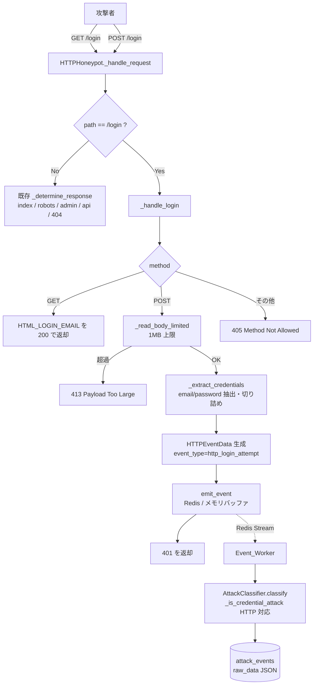

# Design Document

## Overview

本機能は、既存の `HTTPHoneypot`（`src/honeywatch/honeypot/http.py`）に「email と password だけの簡易ログインフォーム」を追加し、攻撃者が POST 送信した認証情報（email / password）を構造化して攻撃イベントとして収集・保存・分類できるようにする。

実装は既存コンポーネント（`AttackEvent` / `HTTPEventData` / `BaseHoneypot.emit_event` / `AttackClassifier` / `CredentialAttackRule` / `AttackEventModel`）を優先活用し、新規の外部依存は追加しない（`hypothesis` は既に dev 依存に含まれる）。

本設計が解決する課題は次の4点である。

1. **ログインフォーム提供**: `GET /login` で email/password のみを持つフォームを HTTP 200 で返す（既存 `/login` は `ADMIN_PATHS` 経由で 401 + `user`/`pass` フォームを返していたため、`/login` を専用ハンドリングに分岐させる）。
2. **認証情報抽出**: `POST /login` で form ボディから email/password を抽出し、`Max_Credential_Length` で切り詰めて `Credential_Submission` を生成、401 を返す。
3. **イベント記録**: 抽出結果を `event_type="http_login_attempt"` の `AttackEvent` として `raw_data`（`HTTPEventData` 拡張）に含め、既存の `emit_event`（Redis 断時メモリバッファ）経由で発行する。
4. **分類対応**: `AttackClassifier._is_credential_attack` を `http_login_attempt` に対応させる。SSH 既存挙動は不変に保つ。

加えて、ボディサイズ上限（1 MB）、GET/POST 以外のメソッド拒否、form 解析失敗時の継続処理、password 平文のアプリケーションログ非出力を実現する。

### 要件トレーサビリティ（概要）

| Requirement | 対応する設計要素 |
|-------------|------------------|
| 1. 簡易ログインフォーム提供 | `HTML_LOGIN_EMAIL` テンプレート、`_handle_login`（GET/POST 分岐）、`_read_body_limited`、メソッド制限 |
| 2. 認証情報抽出 | `_extract_credentials`、`Max_Credential_Length` 切り詰め、form 解析失敗ハンドリング |
| 3. 認証情報イベント記録 | `HTTPEventData` 拡張、`event_type="http_login_attempt"`、`emit_event` 再利用 |
| 4. HTTP 認証情報攻撃の分類 | `AttackClassifier._is_credential_attack` の HTTP 対応、`CredentialAttackRule` 拡張 |
| 5. 収集データの機密性配慮 | 2項目限定保存、`CredentialSettings.max_credential_length`、ログマスキング |

## Architecture

### 全体フロー

本機能は既存のレイヤー構成（Honeypot → Collector → Detection → Database → API）に沿う。新規追加は Honeypot 層のリクエスト処理分岐と、Detection 層の分類条件追加に限定される。



### 設計判断と根拠

- **`/login` を専用分岐にする**: 現状 `/login` は `ADMIN_PATHS` に含まれ `_determine_response` 内で 401 + `HTML_LOGIN`（`user`/`pass`）を返す。要件 1 は GET で **200** かつ **email/password のみ**のフォームを要求するため、`_handle_request` の冒頭で `path == "/login"` を判定し `_handle_login` に委譲する。これにより既存の他パス（index / robots / admin / api / 404）の挙動は一切変えない。`ADMIN_PATHS` からは `/login` を除外し、他の管理系パス（`/admin` 等）の既存 401 挙動は維持する。
- **ボディ読み取りを上限付きに変更**: 現状 `await request.read()` は無制限にボディ全体を読む。要件 1.6（1 MB 超過は拒否・永続化しない）を満たすため、`/login` POST では `Content-Length` と逐次読み取りサイズの両方を 1 MB で打ち切る `_read_body_limited` を用いる。既存の全リクエスト記録パス（`_handle_request` の `body_preview`）は先頭 1024 バイトのみ保持のため影響は限定的だが、本機能の POST 経路では上限を明示的に適用する。
- **既存の `emit_event` を再利用**: Redis 接続断時のメモリバッファ（`BaseHoneypot._buffer`）はそのまま使う。要件 3.6 のバッファ要件は追加実装なしで満たされる。
- **分類器は protocol 分岐を追加**: SSH 既存挙動（要件 4.5）を壊さないため、`_is_credential_attack` を protocol ごとに分岐させ、`ssh` の既存ロジックは完全に温存する。`http` は `http_login_attempt` のときのみ email/password を弱資格情報リストと照合する。
- **password をログに出さない**: `logger.info("http_honeypot.login_attempt", ...)` では email の長さ・path・status のみを記録し、password 値および email 値そのものは出力しない（要件 5.6）。`raw_data`（＝ DB の `raw_data` JSON）には平文保持するが、これは分析目的の意図的な保存であり SSH の先行判断に準拠する。

## Components and Interfaces

### 1. HTTPHoneypot（`src/honeywatch/honeypot/http.py`）

#### 新規テンプレート

```python
# email / password のみを持つログインフォーム（要件 1.1〜1.3）
HTML_LOGIN_EMAIL = """<!DOCTYPE html>
<html>
<head><title>Login</title></head>
<body>
<h1>Authorization Required</h1>
<form method="POST" action="/login">
    <label>Email: <input type="email" name="email"></label><br>
    <label>Password: <input type="password" name="password"></label><br>
    <input type="submit" value="Login">
</form>
</body>
</html>"""
```

#### 新規・変更メソッド

```python
# 1 MB 上限（要件 1.6）
MAX_BODY_SIZE = 1_048_576
# ログインエンドポイントで許可するメソッド（要件 1.7）
LOGIN_ALLOWED_METHODS = {"GET", "POST"}

async def _handle_request(self, request: web.Request) -> web.Response:
    """全リクエストを処理する。/login は _handle_login に委譲する。"""
    # path 正規化（末尾スラッシュ除去・小文字化）して /login を判定
    # /login 以外は従来どおり既存処理を行う（挙動不変）
    ...

async def _handle_login(self, request: web.Request) -> web.Response:
    """GET /login・POST /login を処理する（要件 1・2・3）。

    - GET  : HTML_LOGIN_EMAIL を 200 + 偽装ヘッダーで返す
    - POST : ボディ上限確認 → 認証情報抽出 → イベント発行 → 401
    - その他メソッド: 405
    """
    ...

async def _read_body_limited(self, request: web.Request) -> bytes | None:
    """ボディを MAX_BODY_SIZE まで読み取る。超過時は None を返す（要件 1.6）。"""
    ...

def _extract_credentials(self, raw_body: bytes) -> CredentialSubmission:
    """form ボディから email/password を抽出・切り詰めする（要件 2）。

    - form 解析可能: email/password を取り出す。無い/空は空文字（要件 2.2, 2.3）
    - form 解析不能: email/password とも空文字、処理は継続（要件 2.5）
    - 各フィールドは Max_Credential_Length で切り詰め（要件 2.4）
    """
    ...
```

- `_handle_login` の POST 分岐は、`_extract_credentials` の結果から `HTTPEventData`（email/password 付き）を構築し、`event_type="http_login_attempt"` の `AttackEvent` を生成して `self.emit_event(event)` を呼ぶ（要件 3.1〜3.6）。発行後に 401 + `HTML_LOGIN_EMAIL`（または認証失敗メッセージ）を返す（要件 1.5）。
- form 解析は aiohttp 既存機能を使わず、`urllib.parse.parse_qs`（標準ライブラリ）で `application/x-www-form-urlencoded` ボディを解析する。これにより新規依存を避け、解析失敗時の制御（要件 2.5）を自前で確実に行える。`Content-Type` が form でない場合も解析失敗として扱い空文字にフォールバックする。

#### メソッド制限・サイズ超過の返却

| 条件 | ステータス | 根拠 |
|------|-----------|------|
| GET /login | 200 | 要件 1.1 |
| POST /login（正常） | 401 | 要件 1.5 |
| POST/GET /login かつボディ > 1 MB | 413 | 要件 1.6 |
| /login かつ GET/POST 以外 | 405 | 要件 1.7 |

いずれのレスポンスにも既存の `FAKE_SERVER_HEADERS`（`Server` / `X-Powered-By`）を付与する（要件 1.4）。

### 2. イベントデータモデル（`src/honeywatch/collector/events.py`）

`HTTPEventData` に email/password の構造化フィールドを **後方互換を保って** 追加する（詳細は Data Models 参照）。`http_request`（既存）では email/password は未設定（None）となり、既存イベントの `model_dump()` 形状は「新フィールドが None で加わる」だけで、既存の読み出しコードは影響を受けない。

### 3. 設定（`src/honeywatch/core/config.py`）

`Max_Credential_Length` を環境変数で設定可能にする新しいサブ設定 `CredentialSettings` を追加し、`Settings` に組み込む（詳細は Data Models 参照）。既定 256、範囲 1〜4096、無効値は 256 にフォールバック（要件 5.2〜5.4）。

### 4. 攻撃分類器（`src/honeywatch/detection/classifier.py`）

`_is_credential_attack` を protocol 分岐に変更する。

```python
def _is_credential_attack(self, event: AttackEvent) -> bool:
    rule = self._rules.attack_types.credential_attack
    if event.protocol == "ssh":
        # 既存ロジックを完全温存（要件 4.5）
        username = event.raw_data.get("username")
        password = event.raw_data.get("password")
        username_match = isinstance(username, str) and username in rule.usernames
        password_match = isinstance(password, str) and password in rule.passwords
        return username_match or password_match
    if event.protocol == "http" and event.event_type == "http_login_attempt":
        # HTTP の Credential_Attack 判定（要件 4.1〜4.4）
        if not rule.http_enabled:
            return False
        email = event.raw_data.get("email")
        password = event.raw_data.get("password")
        email_match = isinstance(email, str) and email != "" and email in rule.emails
        password_match = (
            isinstance(password, str) and password != "" and password in rule.passwords
        )
        return email_match or password_match
    return False
```

- `event.protocol == "http"` でも `event_type != "http_login_attempt"`（＝通常の `http_request`）は従来どおり credential_attack に該当しない。
- 空文字・欠落（None）は一致対象外（要件 4.3, 4.4）。
- `http_enabled` が False（Detection_Rules で無効化）なら HTTP は判定しない（要件 4.2 の WHERE 条件）。

### 5. 検知ルール（`src/honeywatch/detection/patterns.py` / `config/detection_rules.yaml`）

`CredentialAttackRule` に HTTP 用フィールドを追加する（後方互換のためデフォルト値を持たせる）。

```python
class CredentialAttackRule(BaseModel):
    """Credential Attack 判定ルール."""

    protocol: str = "ssh"
    usernames: list[str] = Field(default_factory=list)
    passwords: list[str] = Field(default_factory=list)
    # --- HTTP Credential Attack 用（本機能で追加）---
    http_enabled: bool = True            # 要件 4.2 の WHERE 条件
    emails: list[str] = Field(default_factory=list)  # 既知の弱い email リスト
```

`config/detection_rules.yaml` の `credential_attack` に `http_enabled` と `emails` を追記する（`passwords` は SSH と共用）。YAML 未指定でもデフォルトが効くため既存設定ファイルとの後方互換を保つ。

### 6. DB モデル（`src/honeywatch/db/models.py`）

変更なし。email/password は `AttackEventModel.raw_data`（JSON カラム）に `HTTPEventData.model_dump()` の一部として保存される。`attack_type` / `severity` は既存どおり Event_Worker の分類結果で埋まる（`http_login_attempt` が credential_attack と判定されれば `credential_attack`、そうでなければ既存ロジックに従う）。

## Data Models

### HTTPEventData 拡張（後方互換）

```python
class HTTPEventData(BaseModel):
    """HTTP Honeypot 固有のイベントデータ."""

    method: str = Field(description="HTTP メソッド（GET, POST 等）")
    path: str = Field(description="リクエストパス")
    headers: dict[str, str] = Field(default_factory=dict, description="リクエストヘッダー")
    user_agent: str = Field(default="", description="User-Agent ヘッダー値")
    body_preview: str | None = Field(default=None, description="リクエストボディ先頭 1024 バイト")
    status_code: int = Field(default=200, description="返却したレスポンスのステータスコード")
    # --- 本機能で追加（ログインフォーム認証情報）---
    # http_login_attempt 以外では None。既存イベントとの後方互換のため default=None。
    email: str | None = Field(default=None, description="抽出した email（切り詰め後、平文）")
    password: str | None = Field(default=None, description="抽出した password（切り詰め後、平文）")
```

- **後方互換**: 新フィールドはすべて `default=None`。既存の `http_request` / `ssh_*` イベントや既存 DB レコードの読み出しに影響しない。`model_dump()` には `email`/`password` キーが追加されるが、値は None。
- **欠損の表現**: 要件 3.4 に従い、抽出できなかったフィールドは `raw_data` 上 null（None）とする。一方、要件 2.2/2.3 の「フィールドが無い/空のとき空文字（長さ 0）」は `Credential_Submission` レベルの表現である。両者の整合は下記「CredentialSubmission と raw_data の対応」で定義する。

### CredentialSubmission（Honeypot 内部の中間表現）

form 抽出結果を表す軽量なデータクラス（イベント化前の内部表現）。Pydantic ではなく `dataclass` とし、Honeypot プロセス内でのみ使う。

```python
@dataclass
class CredentialSubmission:
    """ログインフォームから抽出した認証情報（内部中間表現）。

    email / password は常に str（欠落・空・解析失敗時は空文字）。
    各値は Max_Credential_Length 以下に切り詰め済み。
    """
    email: str          # 要件 2.2: 無い/空は "" 、要件 2.4: 切り詰め済み
    password: str       # 要件 2.3: 無い/空は "" 、要件 2.6: 平文原文
    parsed: bool        # form 解析に成功したか（要件 2.5 の判定用）
```

#### CredentialSubmission と raw_data の対応

| 状況 | `CredentialSubmission` | `HTTPEventData.email/password`（raw_data） |
|------|------------------------|---------------------------------------------|
| form 解析成功・値あり | 切り詰め後の値 | 同じ値（str） |
| フィールド無し/空（要件 2.2, 2.3） | `""`（空文字） | `None`（要件 3.4 の欠損 null） |
| form 解析失敗（要件 2.5） | `email=""`, `password=""`, `parsed=False` | 両方 `None`（要件 3.4） |

> 空文字（`CredentialSubmission`）と null（`raw_data`）の変換規則: 抽出時に「そのフィールドが実際に存在し非空だったか」を保持し、存在かつ非空のときのみ `raw_data` に str を設定、それ以外は None にする。これにより要件 2（空文字で中断しない）と要件 3.4（欠損は null）の双方を満たす。

### CredentialSettings（`core/config.py`）

```python
class CredentialSettings(BaseSettings):
    """ログインフォーム認証情報の収集設定."""

    model_config = SettingsConfigDict(env_prefix="CREDENTIAL_")

    # 保存時に適用する各フィールドの最大文字数（要件 5.2〜5.4）
    # 範囲外・非整数は property 側で 256 にフォールバックする。
    max_credential_length_raw: int = 256

    @property
    def max_credential_length(self) -> int:
        """有効な Max_Credential_Length を返す（1〜4096、無効時 256）。"""
        value = self.max_credential_length_raw
        if 1 <= value <= 4096:
            return value
        return 256
```

- `Settings` に `credential: CredentialSettings = CredentialSettings()` を追加する。
- 環境変数名は `CREDENTIAL_MAX_CREDENTIAL_LENGTH`。pydantic-settings が int 変換に失敗する（整数以外）場合も考慮が必要なため、`max_credential_length_raw` は検証に失敗しても例外にせず既定にフォールバックできるよう、取得は `get_settings()` 時の例外処理ではなく「読めた値を property で範囲検証する」方針とする。非整数文字列で `ValidationError` となるケースに備え、Honeypot 側では `max_credential_length` 取得をフォールバック付きで呼ぶ補助関数経由とする（下記）。

```python
def get_max_credential_length() -> int:
    """設定から Max_Credential_Length を取得する。読み取り/検証失敗時は 256。"""
    try:
        return get_settings().credential.max_credential_length
    except Exception:  # 設定読み取り/検証失敗時のフォールバック（要件 5.4）
        return 256
```

### 切り詰めロジック

```python
def _truncate(value: str, limit: int) -> str:
    """value を先頭 limit 文字に切り詰める（要件 2.4, 5.5）。"""
    return value[:limit]
```

- 文字数（Python の str スライス = コードポイント単位）で切り詰める。要件は「文字数」基準のため、バイト単位ではなくコードポイント単位で統一する。

## Correctness Properties

*A property is a characteristic or behavior that should hold true across all valid executions of a system-essentially, a formal statement about what the system should do. Properties serve as the bridge between human-readable specifications and machine-verifiable correctness guarantees.*

本機能は、認証情報の抽出・切り詰め（純粋ロジック）、分類判定（純粋ロジック）、設定クランプ（純粋ロジック）という「入力に応じて挙動が変わる」要素を多く含むため、Property-Based Testing（PBT）が適切である。以下のプロパティは prework の分類（PROPERTY / EDGE_CASE）に基づく。固定テンプレート検証（1.1〜1.4）や既存機構の再利用確認（3.6）は example テストで扱う（Testing Strategy 参照）。

### Property 1: ログイン POST は常に単一の http_login_attempt イベントを発行し 401 を返す

*For any* email 文字列および password 文字列について、`POST /login` を処理すると、ちょうど 1 件の `AttackEvent`（`protocol == "http"`, `event_type == "http_login_attempt"`）が `emit_event` へ発行され、レスポンスのステータスコードは 401 となる。

**Validates: Requirements 1.5, 3.1, 3.2, 2.6**

### Property 2: form 抽出の round-trip（切り詰め範囲内で入力を復元）

*For any* 文字数が Max_Credential_Length 以下の email / password の組について、それらを `application/x-www-form-urlencoded` にエンコードして `_extract_credentials` に渡すと、抽出された `email` / `password` は元の値に一致する。

**Validates: Requirements 2.1**

### Property 3: 欠落・空フィールドは空文字になる

*For any* form ボディについて、`email`（または `password`）フィールドが存在しない、もしくは値が空であるとき、`_extract_credentials` が返す `CredentialSubmission` の該当フィールドは空文字列（長さ 0）になる。

**Validates: Requirements 2.2, 2.3**

### Property 4: 切り詰めは長さ上限を保ちつつ先頭を保存する

*For any* 文字列 s と任意の有効な上限 n（1 ≤ n ≤ 4096）について、`_truncate(s, n)` の結果は長さが n 以下であり、かつ `s[:n]`（元文字列の先頭 n 文字）と一致する。

**Validates: Requirements 2.4, 5.5**

### Property 5: 抽出した認証情報は raw_data に構造化反映される

*For any* 非空の email / password の組について、`POST /login` から生成される `AttackEvent` の `raw_data["email"]` / `raw_data["password"]` は、それぞれ切り詰め後の email / password と一致する。

**Validates: Requirements 3.3**

### Property 6: 弱い資格情報を含む http_login_attempt は credential_attack に分類される

*For any* 既知の弱い email / password リストと、その email リストまたは password リストのいずれかの値に完全一致する（非空の）email または password を持つ `http_login_attempt` イベントについて、HTTP 判定が有効（`http_enabled == True`）であれば、`AttackClassifier` の分類結果は `credential_attack` になる。

**Validates: Requirements 4.1, 4.2**

### Property 7: 弱い資格情報に一致しない http_login_attempt は credential_attack に分類されない

*For any* email も password も既知の弱い資格情報リストのいずれにも一致しない `http_login_attempt` イベントについて、`AttackClassifier` の分類結果は `credential_attack` にならず、分類は例外なく正常終了する。

**Validates: Requirements 4.3, 4.4**

### Property 8: SSH イベントの credential_attack 判定は不変

*For any* username / password を持つ SSH の `AttackEvent` について、変更後の `_is_credential_attack` の判定結果は、既存ロジック（`username in rule.usernames` または `password in rule.passwords`）の結果と常に一致する。

**Validates: Requirements 4.5**

### Property 9: 構造化保存されるのは email / password の 2 項目のみ

*For any* `email` / `password` に加えて任意個数の追加フィールドを含む form ボディについて、`POST /login` から生成される `AttackEvent` の構造化認証データは `email` と `password` の 2 項目のみを含み、それ以外の送信フィールドは構造化データとして現れない。

**Validates: Requirements 5.1**

### Property 10: Max_Credential_Length は有効範囲にクランプされる

*For any* 整数 n について、`max_credential_length` は、n が 1 以上 4096 以下であれば n を返し、そうでなければ既定値 256 を返す。

**Validates: Requirements 5.2, 5.3, 5.4**

### Property 11: password 平文はアプリケーションログに出力されない

*For any* password 文字列について、`POST /login` の処理中に出力されるアプリケーションログのいずれにも、その password の平文値は含まれない。

**Validates: Requirements 5.6**

## Error Handling

| 事象 | 検出箇所 | 挙動 | 根拠 |
|------|----------|------|------|
| ボディサイズ 1 MB 超過 | `_read_body_limited` | 読み取りを打ち切り `None` を返し、`_handle_login` は 413 を返却。イベントは発行しない（永続化しない） | 要件 1.6 |
| GET/POST 以外のメソッド | `_handle_login` 冒頭 | 405 を返却。イベント発行可否は既存の全リクエスト記録方針に従うが、ログインフォーム処理は行わない | 要件 1.7 |
| form 解析失敗（非 form ボディ・不正エンコード） | `_extract_credentials` | `email=""`, `password=""`, `parsed=False` とし、例外を送出せず処理継続。後段のイベント発行は従来どおり実行 | 要件 2.5, 3.4 |
| ボディ読み取り時の例外 | `_read_body_limited` の try/except | デバッグログを出し空ボディ扱いで継続（既存 `_handle_request` の方針を踏襲） | 要件 2.5 |
| 設定値が無効（範囲外・非整数） | `CredentialSettings.max_credential_length` / `get_max_credential_length` | 既定 256 にフォールバック。設定読み取り自体の例外も捕捉して 256 を返す | 要件 5.4 |
| Redis 接続エラー（発行失敗） | `BaseHoneypot.emit_event`（既存） | メモリバッファに一時保持し再接続後 flush（新規実装なし） | 要件 3.6 |

- 例外方針: ログインフォーム処理（抽出・切り詰め・イベント構築）はいずれも例外でリクエスト処理全体を落とさない。form 解析や設定取得の失敗は安全側（空文字 / 既定値）にフォールバックする。
- password を含むエラーログは出さない。エラー時のログは path / status / email 長・エラー種別のみを記録する（要件 5.6）。

## Testing Strategy

既存の pytest 構成（`tests/`、`asyncio_mode = "auto"`）に沿い、以下の方針で検証する。PBT ライブラリは既に dev 依存にある **hypothesis**（`6.112.1`）を使用し、自前実装はしない。各プロパティテストは **最低 100 回**反復する（`@settings(max_examples=100)`）。

### WSL 環境でのテスト実行（tech steering 準拠）

PowerShell → WSL の二重解釈により、`uv run pytest` を直接呼ぶと標準出力が返らないことがある。tech steering の手順に従い、実行内容を `run_checks.sh` に書き出し、`export PATH="$HOME/.local/bin:$PATH"` と `cd <repo>` を含め、結果を `.txt`（`.log` は読み取り不可のため不可）へリダイレクトしてから read で確認する。検証用スクリプト・`.txt` は確認後にユーザーへ削除可否を確認して片付ける。

### テスト配置

| ファイル | 対象 |
|----------|------|
| `tests/test_honeypot/test_http_login_form.py` | ログインフォーム提供・抽出・切り詰め・イベント発行・ログ非漏洩（Property 1〜5, 9, 11、example/edge 群） |
| `tests/test_detection/test_classifier.py`（追記） | HTTP credential_attack 分類・SSH 不変性（Property 6, 7, 8、4.4 edge） |
| `tests/test_core/test_credential_settings.py` | Max_Credential_Length クランプ（Property 10、5.2 example） |

### Property-Based Tests（hypothesis）

各テストは対象プロパティを参照するコメントを付す。タグ形式: **Feature: 7-feat-http-login-form-collection, Property {番号}: {プロパティ本文}**。

| Property | テスト概要 | ジェネレータ |
|----------|-----------|--------------|
| P1 | 任意 email/password を POST → emit 1回・event_type/protocol・401 | `st.text()` × 2 |
| P2 | 範囲内長の email/password を form エンコード→抽出で一致 | 長さ ≤ limit の `st.text()` |
| P3 | email/password を欠落/空にしたボディ→空文字 | 片方欠落/空を含むボディ生成 |
| P4 | 任意文字列 × 任意 limit で len ≤ limit かつ prefix 一致 | `st.text()`, `st.integers(1,4096)` |
| P5 | 非空 email/password → raw_data に切り詰め後値が反映 | 非空 `st.text()` × 2 |
| P6 | 弱リストの値を含む http_login_attempt → credential_attack | 弱リストから `st.sampled_from` |
| P7 | 弱リスト非一致の http_login_attempt → not credential_attack | 弱リスト外になるよう `assume` |
| P8 | 任意 SSH イベント → 既存ロジックと判定一致 | `st.text()` × 2（弱リスト値も混在） |
| P9 | email/password + 余分フィールドの form → 構造化は2項目のみ | 余分キーを `st.dictionaries` |
| P10 | 任意整数 n → n∈[1,4096] なら n、さもなくば 256 | `st.integers()` |
| P11 | 任意 password を POST → ログに平文が現れない | `st.text(min_size=1)` |

- P11 のログ検証は、`structlog` のテスト用キャプチャ（`structlog.testing.capture_logs`）または標準 logging の `caplog` を用い、`POST /login` 処理中に生成された全ログイベントの文字列表現に password 平文が含まれないことを確認する。生成 password が偶然短く他文字列に部分一致しないよう、十分な長さ・一意性を持つ値を生成する。

### Unit / Example Tests

- **1.1〜1.4**（EXAMPLE）: GET /login を1回実行し、status==200、本文の input name 集合 == `{"email", "password"}`（他の入力名を含まない）、`<form method="POST" action="/login">` が単一存在、レスポンスに `Server` / `X-Powered-By` ヘッダーが付与されていることを確認。
- **1.6**（EDGE_CASE）: ボディサイズ境界（1 MB ちょうど→受理・emit あり、1 MB + 1→413・emit なし）。
- **2.5 / 3.4**（EDGE_CASE）: 非 form ボディ（ランダムバイト・JSON・空）で email/password=="" / `raw_data` 該当が None、かつ emit が呼ばれて処理継続することを確認。
- **1.7**（PROPERTY 寄りだが列挙でも可）: `PUT` / `DELETE` / `PATCH` / `HEAD` / `OPTIONS` 等 GET/POST 以外で 405。hypothesis で GET/POST を除くメソッド集合から `sampled_from` して検証してもよい。
- **3.5**（EXAMPLE）: http_login_attempt イベントで `source_ip` / `source_port` / `destination_port` / `method` / `path` が設定されていることを確認。
- **3.6**（EXAMPLE）: `publish` が `ConnectionError` を送出するモック `EventQueue` で POST /login を処理し、`_buffer` に 1 件積まれる（既存機構の再利用確認）。
- **4.4**（EDGE_CASE）: email/password が None / "" の各組み合わせの http_login_attempt で分類結果が `credential_attack` 以外。
- **5.2**（EXAMPLE）: 環境変数未設定で `get_max_credential_length() == 256`。非整数文字列設定時のフォールバック（256）も1ケース確認。

### テストダブル方針

- Honeypot のイベント発行検証は、既存 SSH テスト（`tests/test_honeypot/test_ssh_connection_event.py`）に倣い `emit_event` を `AsyncMock` でモックするか、`EventQueue` の `publish` をモックして発行内容を捕捉する。Redis / DB には依存させない。
- 分類テストは既存 `test_classifier.py` の `rules` / `classifier` フィクスチャを再利用し、`CredentialAttackRule` に `http_enabled` / `emails` を加えたルールで検証する。SSH 既存テスト（`test_credential_attack_by_username` 等）は変更せず全てパスし続けること（要件 4.5 の回帰防止）。

### カバレッジ方針

- プロパティテストで入力空間を広く覆い、example/edge テストで境界・固定構造・既存機構の再利用を補完する。ユニットテストは過剰に増やさず、固定テンプレート・境界・回帰確認に限定する。
- 変更後は `uv run pytest` / `uv run mypy .` / `uv run ruff check <変更ファイル>` を上記 WSL 手順で実行し、既存テストの回帰が無いことを確認する。
