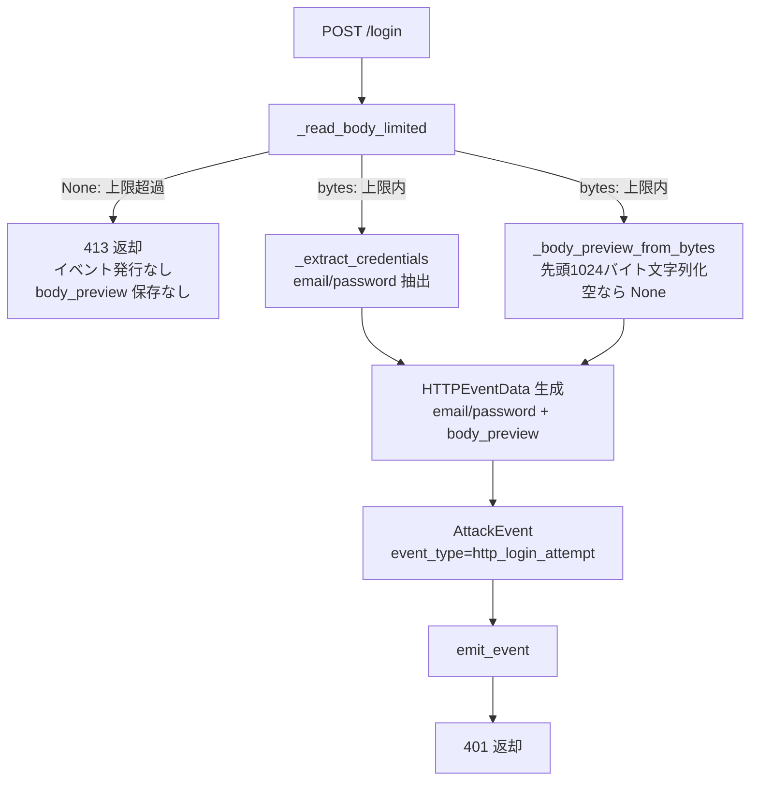

# Design Document

## Overview

本修正は、親フェーズ spec [7-feat-http-login-form-collection](../7-feat-http-login-form-collection/design.md) で実装した `HTTPHoneypot._handle_login`（`src/honeywatch/honeypot/http.py`）の POST 分岐を変更し、`/login` 経路でも生ボディ先頭 1024 バイトを `HTTPEventData.body_preview` に保持するようにする。構造化フィールド（`email` / `password`）の保持は親フェーズのまま維持し、生ボディと構造化データの「両方」を保存する。

親フェーズの現状実装では、`_handle_login` の POST 分岐で `body_preview=None` を明示設定しており、ログイン経路の生ボディが保存されていない。本修正はこの 1 点を中心とした最小変更であり、新規コンポーネント・新規依存・DB スキーマ変更は不要である。`body_preview` フィールド自体は既存の `HTTPEventData` に既にあるため、モデル変更も不要。

### 課題と解決方針

1. **生ボディが落ちている**: `_handle_login` の POST 分岐で `body_preview=None` 固定になっている。既に `_read_body_limited` が読み取ったボディバイト列を再利用し、先頭 1024 バイトを文字列化して `body_preview` に設定する（要件 1.1, 1.4）。
2. **両方保持の整合**: 構造化（`email` / `password`）は親フェーズのまま維持し、生ボディ断片を加える（要件 1.2）。
3. **空ボディ・上限超過の整合**: 空ボディ時は `None`（要件 1.3）、1 MB 超は従来どおり 413 でイベント非発行・`body_preview` 非保存（要件 1.5）。
4. **既存挙動の非回帰**: `/login` 以外（要件 2.5）、401/event_type/構造化2項目限定/ログ非出力/基本フィールド（要件 2.1〜2.4）は変更しない。

### 要件トレーサビリティ（概要）

| Requirement | 対応する設計要素 |
|-------------|------------------|
| 1.1, 1.4 | `_handle_login` POST 分岐で `raw_body` を再利用し先頭 1024 バイトを文字列化（`_body_preview_from_bytes` ヘルパ） |
| 1.2 | `email` / `password` の設定ロジックは不変、`body_preview` を追加設定 |
| 1.3 | 空バイト列のとき `body_preview=None` |
| 1.5 | 既存の `_read_body_limited` が `None` を返す経路（413・イベント非発行）は不変 |
| 2.1〜2.4 | POST 分岐の 401・`event_type`・構造化2項目・ログ出力・基本フィールドのコードは不変 |
| 2.5 | `_handle_request` は変更しない |
| 3.1 | GET 分岐の `body_preview=None` は不変 |

## Architecture

本修正は Honeypot 層の `_handle_login` POST 分岐内に閉じる。全体フローは親フェーズのままで、POST 経路のイベントデータ生成直前に「生ボディ先頭断片の算出」が加わるだけである。



### 設計判断と根拠

- **読み取り済みバイト列の再利用**: `_read_body_limited` が返す `raw_body`（`bytes`）をそのまま使い、先頭 1024 バイトを切り出す。aiohttp のストリームは一度しか読めないため、ここで再読み取りはできず、再利用が唯一正しい方法でもある（要件 1.4）。
- **`_handle_request` と同じ文字列化規則に揃える**: 既存 `_handle_request` は `body_bytes[:1024].decode("utf-8", errors="replace")`、空なら `None`。これと完全に同じ規則を使い、経路間で `body_preview` の表現を一貫させる（要件 1.1, 1.3, 2.5）。共通化のため小さなモジュール関数 `_body_preview_from_bytes(body: bytes) -> str | None` を切り出し、`_handle_request` と `_handle_login` の両方から使う（任意の軽微リファクタ。挙動は不変）。
- **構造化2項目限定は維持**: `body_preview` は生ボディの断片であり「構造化データ」ではないため、親フェーズ要件 5.1（構造化は email/password の2項目のみ）とは矛盾しない。`HTTPEventData` の構造化フィールドは `email` / `password` のまま増やさない（要件 2.2）。
- **ログ非出力は維持**: `body_preview` は `raw_data`（DB）にのみ入り、`logger.info("http_honeypot.login_attempt", ...)` の出力項目には加えない。password 平文も従来どおりログに出さない（要件 2.3）。
- **GET は対象外**: GET /login は通常ボディを持たないため `body_preview=None` のまま。過剰保存を避ける（要件 3.1）。

## Components and Interfaces

### HTTPHoneypot（`src/honeywatch/honeypot/http.py`）

#### 新規ヘルパ関数（モジュールレベル）

```python
# body_preview に保持する先頭バイト数（既存 _handle_request と同一値）
BODY_PREVIEW_LIMIT = 1024

def _body_preview_from_bytes(body: bytes) -> str | None:
    """生ボディの先頭 BODY_PREVIEW_LIMIT バイトを文字列化する.

    既存 _handle_request と同一規則: 非空なら先頭 1024 バイトを
    UTF-8（デコード不能バイトは置換）で文字列化、空なら None。

    Args:
        body: リクエストボディのバイト列。

    Returns:
        先頭 1024 バイトの文字列、空ボディ時は None。
    """
    if not body:
        return None
    return body[:BODY_PREVIEW_LIMIT].decode("utf-8", errors="replace")
```

- `_handle_request` 内の既存インライン処理も、この関数呼び出しに置き換えてよい（挙動不変の軽微な共通化）。必須ではないが一貫性のため推奨。

#### `_handle_login` POST 分岐の変更

変更は POST 分岐の `HTTPEventData` 生成箇所に限定する。

変更前（親フェーズ）:

```python
submission = self._extract_credentials(raw_body)
email_value = submission.email if submission.email else None
password_value = submission.password if submission.password else None
...
http_data = HTTPEventData(
    method=method,
    path=request.path,
    headers={k: v for k, v in request.headers.items()},
    user_agent=request.headers.get("User-Agent", ""),
    body_preview=None,            # ← 生ボディを保存していない
    status_code=401,
    email=email_value,
    password=password_value,
)
```

変更後:

```python
submission = self._extract_credentials(raw_body)
email_value = submission.email if submission.email else None
password_value = submission.password if submission.password else None
# 読み取り済みボディを再利用して生ボディ先頭断片を保持する（要件 1.1, 1.4）。
# 空ボディは None（要件 1.3）。_handle_request と同一規則。
body_preview = _body_preview_from_bytes(raw_body)
...
http_data = HTTPEventData(
    method=method,
    path=request.path,
    headers={k: v for k, v in request.headers.items()},
    user_agent=request.headers.get("User-Agent", ""),
    body_preview=body_preview,    # ← 生ボディ先頭1024バイト（または None）
    status_code=401,
    email=email_value,
    password=password_value,
)
```

- `raw_body` は本分岐到達時点で `None` ではない（`None` は手前の 413 経路で早期 return 済み）。したがって `raw_body` は常に `bytes`。
- GET 分岐・405・413 の各経路は変更しない。

### 他コンポーネント

- `src/honeywatch/collector/events.py`（`HTTPEventData`）: 変更なし（`body_preview` は既存フィールド）。
- `src/honeywatch/db/models.py`: 変更なし（`raw_data` JSON カラムに格納）。
- 分類器・検知ルール・設定: 変更なし。

## Data Models

変更なし。`HTTPEventData.body_preview`（`str | None`、既存）に、POST /login でも値が入るようになるだけ。`model_dump()` の形状は不変で、既存レコードとの後方互換も保たれる。

| 経路 | body_preview | email / password |
|------|--------------|------------------|
| `/login` 以外（_handle_request） | 先頭1024バイト（空なら None）※不変 | None |
| GET /login | None ※不変 | None |
| POST /login（本修正） | **先頭1024バイト（空なら None）** | 切り詰め済み（または None） |

## Correctness Properties

### Property 1: POST /login は生ボディ先頭1024バイトを body_preview に保持する

*For any* MAX_BODY_SIZE 以下の非空バイト列 `b` を POST /login のボディとして処理すると、発行される `AttackEvent` の `raw_data["body_preview"]` は `b[:1024].decode("utf-8", errors="replace")` と一致する。

**Validates: Requirements 1.1, 1.4**

### Property 2: 空ボディの POST /login は body_preview を None にする

*For any* 空ボディ（長さ 0）の POST /login について、発行される `AttackEvent` の `raw_data["body_preview"]` は `None` である。

**Validates: Requirements 1.3**

### Property 3: POST /login は email/password と body_preview を同時に保持する

*For any* `email=...&password=...` を含む form ボディの POST /login について、発行される `AttackEvent` の `raw_data` は、構造化フィールド（`email` / `password`）と `body_preview`（非 None）の両方を含む。

**Validates: Requirements 1.1, 1.2**

### Property 4: 上限超過時は body_preview を保存しない

*For any* MAX_BODY_SIZE を超えるボディの POST /login について、ステータスは 413 であり、`emit_event` は呼ばれず、`body_preview` は保存されない。

**Validates: Requirements 1.5**

### Property 5: 構造化保存は email/password の2項目のみ（不変）

*For any* `email` / `password` に加えて任意個数の追加フィールドを含む form ボディについて、`AttackEvent` の構造化認証データは `email` / `password` の2項目のみを含む（`body_preview` は生断片であり構造化データには数えない）。

**Validates: Requirements 2.2**

## Error Handling

| 事象 | 検出箇所 | 挙動 | 根拠 |
|------|----------|------|------|
| ボディサイズ 1 MB 超過 | `_read_body_limited`（既存） | `None` 返却→413・イベント非発行・`body_preview` 非保存 | 要件 1.5 |
| ボディ読み取り例外 | `_read_body_limited`（既存） | 空ボディ `b""` として継続→`_body_preview_from_bytes(b"")` は `None` | 要件 1.3 |
| デコード不能バイトを含む生ボディ | `_body_preview_from_bytes` | `errors="replace"` で置換し文字列化（例外を出さない） | 要件 1.1 |

- 本修正で新たな例外経路は追加しない。文字列化は `errors="replace"` のため UnicodeDecodeError を送出しない。

## Testing Strategy

親フェーズと同じ pytest 構成（`tests/`、`asyncio_mode = "auto"`）に沿う。PBT は既存 dev 依存の **hypothesis** を用い、各プロパティテストは `@settings(max_examples=100)` 以上で反復する。WSL でのテスト実行は tech steering の手順（`run_checks.sh` に書き出し `.txt` へリダイレクト→read で確認）に従う。

### テスト配置

| ファイル | 対象 |
|----------|------|
| `tests/test_honeypot/test_http_login_form.py`（追記） | 本修正の Property 1〜5、空ボディ・両方保持・上限超過の例/境界 |

### Property-Based / Example Tests

| Property | テスト概要 | ジェネレータ |
|----------|-----------|--------------|
| P1 | 非空ボディ POST → `body_preview == b[:1024] の replace デコード` | 長さ 1〜数 KB の `st.binary()` |
| P2 | 空ボディ POST → `body_preview is None` | 固定（空ボディ） |
| P3 | `email=..&password=..` POST → `email`/`password` と `body_preview` が同時に存在 | 非空 `st.text()` × 2 を urlencode |
| P4 | 1 MB 超 POST → 413・emit なし・保存なし | 1 MB + 1 の境界 |
| P5 | 余分フィールド付き form POST → 構造化は2項目のみ | 余分キーを `st.dictionaries` |

- P1 のデコード検証は、生成バイト列が本修正の文字列化規則（`b[:1024].decode("utf-8", errors="replace")`）と一致することを確認する。
- 既存の親フェーズテスト（401・event_type・ログ非漏洩・SSH 回帰等）は変更せず、全てパスし続けることを回帰確認する。
- `emit_event` は `AsyncMock`、`EventQueue.publish` をモックして発行内容を捕捉する方針（親フェーズと同一）。Redis / DB には依存させない。

### 回帰確認

- 変更後は `uv run pytest` / `uv run mypy .` / `uv run ruff check src/honeywatch/honeypot/http.py` を WSL 手順で実行し、親フェーズテストの回帰が無いこと・新規テストが全てパスすることを確認する。
