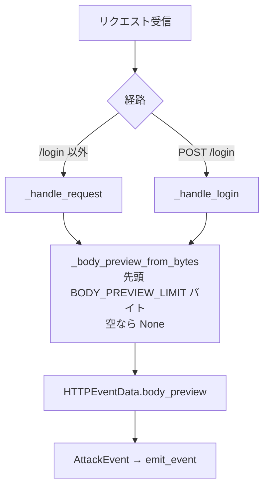

# Design Document

## Overview

本修正は、`src/honeywatch/honeypot/http.py` のモジュール定数 `BODY_PREVIEW_LIMIT` を `1024` から `8192` へ変更し、全リクエスト経路の `body_preview` 保持上限を先頭 8192 バイト（8 KB）へ引き上げるものである。

現状、生ボディ先頭断片の文字列化は共通ヘルパ `_body_preview_from_bytes(body: bytes) -> str | None` に集約されており、`_handle_request`（/login 以外）と `_handle_login`（POST /login）の両経路がこのヘルパを呼び出している。ヘルパは `body[:BODY_PREVIEW_LIMIT].decode("utf-8", errors="replace")`（非空時）、`None`（空ボディ時）を返す。したがって `BODY_PREVIEW_LIMIT` を変更するだけで、両経路の保持上限が一括で切り替わる。

本修正は定数値の変更を中心とした最小変更であり、新規コンポーネント・新規依存・DB スキーマ変更・新たな例外経路は一切不要である。`body_preview` フィールドは `str | None` のままで、`model_dump()` の形状も変わらない。

### 課題と解決方針

1. **先頭 1024 バイトで切り詰められ RCE ペイロードが欠落する**: `BODY_PREVIEW_LIMIT = 1024` が原因。これを `8192` に変更し、1 KB を超える RCE ペイロード（Base64 エンコードされた複数コマンド、末尾のダウンロード元 URL 等）を末尾まで保持する（要件 1.1, 1.2, 1.3）。
2. **保存規則・適用経路は不変**: 文字列化規則（先頭 N バイト・`errors="replace"`・空ボディは `None`）とヘルパ共通化構成は変更しない。変えるのは定数値のみ（要件 2.1, 2.2）。
3. **空ボディの整合**: 空ボディ時は従来どおり `None`（要件 1.4）。
4. **読み取り上限は不変**: `MAX_BODY_SIZE`（1 MB）は変更しない。1 MB 超のボディ拒否挙動（POST /login は 413・イベント非発行）も不変（要件 3.1, 3.2）。
5. **機密性配慮の維持**: 構造化データは `email` / `password` の 2 項目のみ、password 平文・`body_preview` のログ非出力も不変（要件 2.3, 2.4）。

### 要件トレーサビリティ（概要）

| Requirement | 対応する設計要素 |
|-------------|------------------|
| 1.1 | `BODY_PREVIEW_LIMIT = 8192` へ変更 |
| 1.2, 1.3 | `_body_preview_from_bytes` の `body[:BODY_PREVIEW_LIMIT]` が新上限で切り出す（規則不変） |
| 1.4 | 空ボディ時 `None`（ヘルパの早期 return、不変） |
| 2.1, 2.2 | ヘルパの文字列化規則・両経路共通化構成は不変 |
| 2.3, 2.4 | 構造化2項目限定・ログ非出力のコードは不変 |
| 3.1, 3.2 | `MAX_BODY_SIZE` と `_read_body_limited` の 413・非発行経路は不変 |

## Architecture

本修正はモジュール定数 1 行の値変更に閉じる。処理フロー・経路構成は親フェーズおよび 7.01 のままで、`_body_preview_from_bytes` が切り出すバイト数の上限だけが 1024→8192 に変わる。



`BODY_PREVIEW_LIMIT` は単一の定義箇所（モジュールレベル）で参照されるため、値の変更は両経路に自動的に波及する。

### 設計判断と根拠

- **定数値のみの変更**: 保持上限はすでに `BODY_PREVIEW_LIMIT` 定数に一元化されているため、値の変更が最小かつ最も安全な修正である。ヘルパのシグネチャ・文字列化規則・呼び出し側はいずれも変更不要（要件 1.1, 2.1, 2.2）。
- **8192 の選択根拠**: 実運用で観測された RCE ペイロード（CVE-2024-4577 系。`Content-Length` が 1 KB 強）を末尾まで取り切りつつ、無差別スキャンの巨大ボディ全体は保存しない割り切りを維持する。8 KB は一般的な RCE ペイロードを広くカバーする一方、`MAX_BODY_SIZE`（1 MB）より十分小さく、1 イベントあたりの保存量増加は限定的（要件 1.1）。
- **MAX_BODY_SIZE は据え置き**: 読み取り上限と保存上限は別レイヤーの関心事であり、本修正は「保存する断片の長さ」だけを対象とする。読み取り上限を変えるとストレージ・DoS 耐性の方針に影響するため、本修正の範囲外とする（要件 3.1）。
- **先頭断片方針の維持**: 上限を引き上げても「生ボディ全体ではなく先頭断片のみ保持」という方針は変えない。フィールド名 `body_preview` の意味（プレビュー＝先頭断片）と整合する。
- **後方互換**: 既存レコードの `body_preview`（最大 1024 文字相当）はそのまま有効。本修正以降に収集されるレコードが最大 8192 バイト相当になるだけで、スキーマ・読み出し側の変更は不要。

## Components and Interfaces

### HTTPHoneypot（`src/honeywatch/honeypot/http.py`）

#### モジュール定数の変更

変更前:

```python
# body_preview に保持する生ボディの先頭バイト数（既存 _handle_request と同一値）。
BODY_PREVIEW_LIMIT = 1024
```

変更後:

```python
# body_preview に保持する生ボディの先頭バイト数。
# 1 KB を超える RCE ペイロード（Base64 エンコードされた複数コマンド等）を
# 末尾まで観測するため 8 KB とする（修正 spec 7.02）。MAX_BODY_SIZE（読み取り
# 上限 1 MB）とは別レイヤーで、あくまで「保存する断片の長さ」を表す。
BODY_PREVIEW_LIMIT = 8192
```

#### `_body_preview_from_bytes`（既存・変更なし）

```python
def _body_preview_from_bytes(body: bytes) -> str | None:
    if not body:
        return None
    return body[:BODY_PREVIEW_LIMIT].decode("utf-8", errors="replace")
```

- 実装は変更しない。参照する `BODY_PREVIEW_LIMIT` が 8192 になることで、切り出し上限が自動的に引き上がる。
- docstring 内に「先頭 1024 バイト」等の固定値が記載されている場合は、定数名に言及する表現へ調整してよい（挙動不変の軽微な文言整合。必須ではない）。

#### 呼び出し側（`_handle_request` / `_handle_login`）

- いずれも変更なし。`_body_preview_from_bytes(...)` の呼び出しはそのまま。

### 他コンポーネント

- `src/honeywatch/collector/events.py`（`HTTPEventData`）: 変更なし（`body_preview` は既存の `str | None` フィールド）。
- `src/honeywatch/db/models.py`: 変更なし（`raw_data` JSON カラムに格納）。
- 分類器・検知ルール・設定・フロントエンド: 変更なし。

## Data Models

変更なし。`HTTPEventData.body_preview`（`str | None`、既存）の取り得る文字列長の上限が 1024 相当から 8192 相当へ広がるだけで、型・`model_dump()` の形状は不変。既存レコードとの後方互換も保たれる。

| 経路 | body_preview（本修正後） |
|------|--------------------------|
| `/login` 以外（_handle_request） | 先頭 8192 バイト（空なら None） |
| GET /login | None（不変） |
| POST /login | 先頭 8192 バイト（空なら None） |

## Correctness Properties

### Property 1: body_preview 保持上限は 8192 である

`BODY_PREVIEW_LIMIT` の値は `8192` である。

**Validates: Requirements 1.1**

### Property 2: 8192 バイト超のボディは先頭 8192 バイトに切り詰めて保持する

*For any* 長さ 8192 超のバイト列 `b` について、`_body_preview_from_bytes(b)` は `b[:8192].decode("utf-8", errors="replace")` と一致し、その文字列の UTF-8 バイト長は切り出し基準の 8192 バイトに対応する（デコード不能バイトは置換される）。

**Validates: Requirements 1.2**

### Property 3: 8192 バイト以下の非空ボディは全体を保持する

*For any* 長さ 1〜8192 の非空バイト列 `b` について、`_body_preview_from_bytes(b)` は `b.decode("utf-8", errors="replace")` と一致する（切り詰めが発生しない）。

**Validates: Requirements 1.3**

### Property 4: 空ボディは None を返す（不変）

空バイト列 `b""` について、`_body_preview_from_bytes(b"")` は `None` である。

**Validates: Requirements 1.4**

### Property 5: 読み取り上限と 413 経路は不変

*For any* MAX_BODY_SIZE を超えるボディの POST /login について、ステータスは 413 であり、`emit_event` は呼ばれず、`body_preview` は保存されない。

**Validates: Requirements 3.1, 3.2**

## Error Handling

| 事象 | 検出箇所 | 挙動 | 根拠 |
|------|----------|------|------|
| ボディサイズ 1 MB 超過 | `_read_body_limited`（既存・不変） | `None` 返却→413・イベント非発行・`body_preview` 非保存 | 要件 3.1, 3.2 |
| デコード不能バイトを含む生ボディ | `_body_preview_from_bytes`（既存・不変） | `errors="replace"` で置換し文字列化（例外を出さない） | 要件 2.1 |
| 空ボディ | `_body_preview_from_bytes`（既存・不変） | `None` を返す | 要件 1.4 |

- 本修正で新たな例外経路は追加しない。定数値の変更のみであり、文字列化は従来どおり `errors="replace"` で UnicodeDecodeError を送出しない。

## Testing Strategy

親フェーズ・7.01 と同じ pytest 構成（`tests/`、`asyncio_mode = "auto"`）に沿う。PBT は既存 dev 依存の **hypothesis** を用い、各プロパティテストは `@settings(max_examples=100)` 以上で反復する。WSL でのテスト実行は tech steering の手順（`run_checks.sh` に書き出し `.txt` へリダイレクト→read で確認）に従う。

### テスト配置

| ファイル | 対象 |
|----------|------|
| `tests/test_honeypot/test_http_login_form.py`（追記） | 本修正の Property 1〜5。ヘルパ単体の境界（8192 前後）と POST /login 経路の end-to-end |

### Property-Based / Example Tests

| Property | テスト概要 | ジェネレータ |
|----------|-----------|--------------|
| P1 | `BODY_PREVIEW_LIMIT == 8192` | 固定（定数検証） |
| P2 | 長さ 8192 超のボディ → `body_preview == b[:8192] の replace デコード` | 長さ 8193〜十数 KB の `st.binary()` |
| P3 | 長さ 1〜8192 の非空ボディ → `body_preview == b 全体の replace デコード`（切り詰めなし） | 長さ 1〜8192 の `st.binary()` |
| P4 | 空ボディ → `body_preview is None` | 固定（空ボディ） |
| P5 | 1 MB 超 POST → 413・emit なし・保存なし（不変） | 1 MB + 1 の境界 |

- P2/P3 の境界（8192 ちょうど・8193）を example テストで明示的に確認し、オフバイワンが無いことを担保する。
- 既存の親フェーズ・7.01 テスト（401・event_type・両方保持・ログ非漏洩・上限超過・SSH 回帰等）は変更せず、全てパスし続けることを回帰確認する。1024 固定を前提にしたテストが存在する場合は、新上限（8192）に合わせて期待値を更新する。
- `emit_event` は `AsyncMock`、`EventQueue.publish` をモックして発行内容を捕捉する方針（親フェーズと同一）。Redis / DB には依存させない。

### 回帰確認

- 変更後は `uv run pytest` / `uv run mypy .` / `uv run ruff check src/honeywatch/honeypot/http.py` を WSL 手順で実行し、親フェーズ・7.01 テストの回帰が無いこと・新規テストが全てパスすることを確認する。
